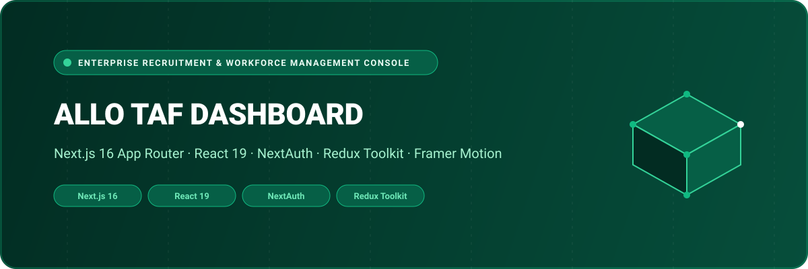

<div align="center">



# Allo Taf Dashboard — Enterprise Recruitment & Workforce Operations Console

A centralized administration and operations console managing on-demand staffing pipelines, recruiter subscriptions, job vacancy moderations, and candidate verification. Engineered with **Next.js 16 (App Router)**, **React 19**, **NextAuth**, **Redux Toolkit**, **Framer Motion**, and **Tailwind CSS**.

[](https://nextjs.org/)
[](https://react.dev/)
[](https://next-auth.js.org/)
[](https://redux-toolkit.js.org/)
[](https://www.typescriptlang.org/)
[](LICENSE)

</div>

---

## 🌟 Overview

**Allo Taf Dashboard** equips enterprise operations teams, account managers, and platform administrators with end-to-end governance over the Allo Taf staffing ecosystem. From auditing company recruiter accreditations and monitoring active shift vacancies to managing recurring recruiter subscription packages and user privacy compliance, the portal unifies back-office workflows into a modern web console.

Synchronized with the [`Allo_Taf`](https://github.com/shahjalal-labs/Allo_Taf) mobile applications, administrators maintain real-time oversight of market supply and demand.

---

## 🚀 Key Features & Capabilities

- 🏢 **Recruiter Accreditation & Vetting**: Verify company registration documents, track hiring volumes, and approve enterprise recruiter profiles.
- 💼 **Job Vacancy Moderation**: Review posted shifts and job listings for wage transparency, category classification, and compliance.
- 💳 **Recruitment Subscriptions & Billing**: Manage recruiter membership tiers, resume library access limits, and subscription renewal records.
- 👤 **Worker Directory & Dispute Audit**: Search candidate profiles, view verification badges, and inspect rating feedback.
- 🔐 **NextAuth RBAC Security**: Multi-factor authentication, secure session cookies, and granular operational permission levels.
- ✨ **Fluid Interface & Micro-Interactions**: Animated UI components powered by Framer Motion, Lottie animations, and Lucide icons.

---

## 🏛️ System Architecture

```
[ Operations Managers & Admins ]
               │
               ▼
   [ Next.js 16 App Router Management Portal ]
   ├── Recruiter Corporate Vetting & Approvals
   ├── Shift Listings & Vacancy Moderation
   ├── B2B Recruiter Subscription Tier Engine
   ├── Worker Credential Audits & Dispute Logs
   └── Platform Policy & Regulatory Administration
               │
               ▼ (RTK Query / HTTPS REST)
   [ Allo Taf Backend Services & Database ]
```

---

## 📁 Repository Structure

```
Allo-Taf_Dashboard/
├── assets/
│   └── banner.svg                  # Architectural SVG project banner
├── public/                         # Brand logos, icons, and static illustrations
├── app/
│   ├── (auth)/                     # Administrative authentication routes
│   │   └── auth/                   # Sign-in and credential verification
│   ├── (dashboard)/                # Primary operations portal
│   │   ├── dashboard/              # Core management modules
│   │   │   ├── jobs/               # Shift listings & job post moderation
│   │   │   ├── recruiters/         # Corporate hiring accounts & verification
│   │   │   ├── users/              # Candidate accounts & employment logs
│   │   │   ├── subscriptions/      # Recruiter tier packages & billing
│   │   │   └── settings/           # System configuration & localization
│   │   └── layout.tsx              # Persistent administrative sidebar & topbar
│   ├── (common)/                   # Terms, privacy policies, account deletion
│   ├── api/                        # NextAuth authentication API routes
│   ├── layout.tsx                  # Root layout with Redux & Theme providers
│   └── globals.css                 # Tailwind CSS styling and theme tokens
├── components/                     # Reusable data tables, metric cards, modals
├── redux/                          # Centralized state management & RTK Query
├── utils/                          # Formatting helpers and date calculators
├── package.json                    # Dependencies (Next.js 16, React 19, NextAuth)
└── tsconfig.json                   # Strict TypeScript compiler options
```

---

## 💻 Tech Stack Specification

| Domain | Selected Technologies |
| :--- | :--- |
| **Framework** | Next.js 16.2.9 (App Router) |
| **Runtime & React** | React 19.2.4 & React DOM 19 |
| **Language** | TypeScript 5 (Strict Mode) |
| **Authentication** | NextAuth.js 4.24, JWT Decode |
| **State Management** | Redux Toolkit (RTK), RTK Query |
| **Motion & UX** | Framer Motion, Lottie React, Lucide Icons |
| **Styling** | Tailwind CSS, PostCSS, Class Variance Authority |

---

## 🛠️ Getting Started & Local Development

### Prerequisites

- **Node.js**: `v20.x` or higher
- **Package Manager**: `npm`, `yarn`, or `pnpm`

### 1. Clone the Repository

```bash
git clone https://github.com/shahjalal-labs/Allo-Taf_Dashboard.git
cd Allo-Taf_Dashboard
```

### 2. Install Dependencies

```bash
npm install
```

### 3. Configure Environment Variables

Create a `.env.local` file:

```env
NEXT_PUBLIC_BASE_URL=http://localhost:5000/api/v1
NEXTAUTH_URL=http://localhost:3000
NEXTAUTH_SECRET=sample_nextauth_secret
```

### 4. Run Development Server

```bash
npm run dev
```

Open [http://localhost:3000](http://localhost:3000) to view the administration console.

---

## 👨‍💻 Engineering & Authorship

Developed and engineered by **Md. Shahjalal**.

- **GitHub**: [@shahjalal-labs](https://github.com/shahjalal-labs)
- **Email**: [muhommodshahjalal@gmail.com](mailto:muhommodshahjalal@gmail.com)

---

## 📄 License

This project is open-source and available under the [ISC License](LICENSE).
